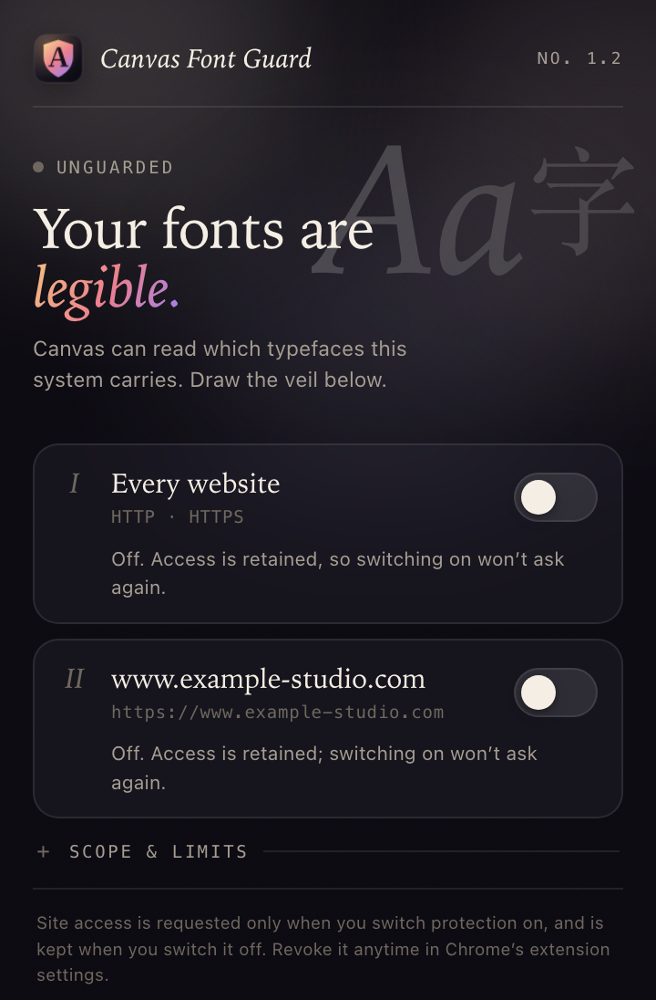
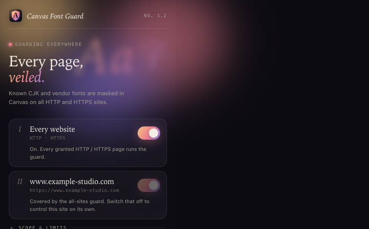
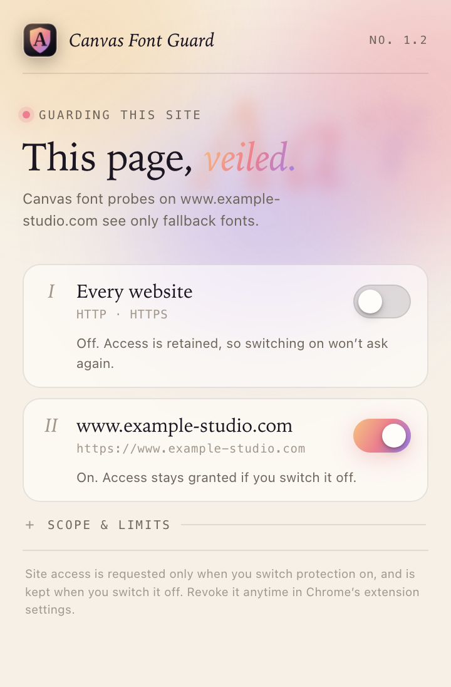

  

<h1 align="center">Canvas Font Guard</h1>

<em>Draw a veil over the typefaces your browser can be fingerprinted by.</em>

  
  &nbsp;
  
  &nbsp;
  

**A Chrome extension that mitigates Canvas font probing, on every site or one site at a time.** Before page scripts run, Canvas Font Guard rewrites a targeted list of known CJK and vendor font names in Canvas 2D, and filters matching entries out of Chrome’s local font enumeration API where it applies. It is a plain Manifest V3 extension with no build step.

> This is a narrowly scoped privacy tool. It cannot guarantee that Chinese fonts on your system stay hidden, and it does not make your browser fingerprint anonymous. Please read [Scope and limits](#scope-and-limits).

## Features

- **All-sites switch.** Grant access to every HTTP / HTTPS site once and stay protected. Switching off only stops the all-sites script; access is retained, so switching back on won’t prompt again.
- **Per-site switch.** Or protect just the current site. Switching it off keeps that site’s access, so re-enabling won’t prompt. While the all-sites switch is on, the per-site switch is paused and its previous setting is kept.
- **Canvas 2D font remapping.** In `CanvasRenderingContext2D` and `OffscreenCanvasRenderingContext2D`, matching family names are mapped to a nonexistent internal family, so Canvas falls back to the rest of the page’s font stack.
- **Local font enumeration filtering.** When `queryLocalFonts()` is available, entries whose `family`, `fullName` or `postscriptName` match are filtered out. Chrome still enforces the API’s secure-context and permission requirements.
- **Runs at document start.** Registered scripts run at `document_start` in the main world, in all frames of matching sites. The current tab reloads when you toggle protection.
- **On-demand permissions.** No site access is granted at install. The all-sites switch requests `http://*/*` and `https://*/*`; the per-site switch requests only the current scheme and host. Switching off unregisters the script but keeps access until you revoke it in Chrome’s extension settings.

## Matched font names

The match list is targeted; it is not a complete catalogue of CJK fonts. Matching is case-insensitive and targets family names. Name boundaries, spacing and the shape of CSS font lists can affect whether a name matches.

| Group | Examples and aliases |
| --- | --- |
| Microsoft | `Microsoft YaHei UI`, `Microsoft YaHei`, `Microsoft JhengHei UI`, `Microsoft JhengHei`, `MicrosoftYaHei`, `MicrosoftJhengHei` |
| Apple / macOS | `PingFang SC`, `PingFang TC`, `PingFang HK`, `PingFang`, `PingFangSC`, `PingFangTC`, `STHeiti`, `STHeiti SC`, `STSong`, `Songti SC`, `Kaiti SC`, `Hiragino Sans GB` |
| Xiaomi | `MiSans VF`, `MiSans`, `Mi Sans`, `MiSansVF`, `Mi Lan Ting`, `Mi Lan Ting Pro` |
| Huawei | `HarmonyOS Sans SC`, `HarmonyOS Sans TC`, `HarmonyOS Sans`, `HarmonyOSSansSC`, `HarmonyOSSans`, `Huawei Sans`, `Huawei HarmonyOS font` |
| Generic CJK / Linux | `Source Han Sans/Serif`, `Noto Sans/Serif CJK`, `Source Han Sans`, `Source Han Serif`, `WenQuanYi Zen Hei`, `WenQuanYi Micro Hei`, `WenQuanYi` |
| Other Chinese and vendor fonts | `SimSun`, `NSimSun`, `SimHei`, `KaiTi`, `FangSong`, `DengXian`, `LiSu`, `YouYuan`, `DFKai-SB`, `MingLiU`, `PMingLiU`, `OPPO Sans`, `vivo Sans`, `Alibaba PuHuiTi`, `Tencent Sans`, `DingTalk JinBuTi`, and their native aliases |

The authoritative list is `protectedFamilies` in [`guard.js`](guard.js). Native Chinese aliases are matched verbatim there and are intentionally not transliterated, because the browser and operating system expose those exact family names.

## Install

### From GitHub

1. On this repository page choose **Code → Download ZIP** and unzip it.
2. Open `chrome://extensions` in Chrome.
3. Turn on **Developer mode** in the top-right corner.
4. Click **Load unpacked** and select the extracted folder (the one containing `manifest.json`).

Unpacked extensions require Developer mode. There is no installer, and the extension never modifies or removes operating-system fonts.

## Usage

If Canvas Font Guard isn’t visible in the toolbar, click Chrome’s Extensions (puzzle piece) button and pin it.

### Protect every site

1. Click the Canvas Font Guard icon in the toolbar.
2. Turn on **I · Every website** and allow access to all sites when Chrome asks.
3. The extension registers the all-sites script and reloads the current page. Every HTTP / HTTPS page you open afterwards is protected automatically.

You usually confirm the all-sites permission only once. Switching it off stops the script but keeps the permission, so switching on again won’t ask. To revoke access, open Canvas Font Guard’s details page in `chrome://extensions`.

### Protect only the current site

1. Make sure **Every website** is off, then open the `http://` or `https://` page you want to protect.
2. Open the popup and turn on **II · ⟨hostname⟩**.
3. Allow access the first time Chrome asks. Later toggles won’t prompt again.

The per-site switch applies to the current **scheme + hostname**. Chrome host patterns ignore ports, so different ports on the same scheme and host share one switch; HTTP and HTTPS are granted separately. Chrome pages, extension pages and `file://` pages are not supported.

### Switching off and reloading

- Switch off **Every website** to stop the all-sites script, or the per-site switch to stop that site’s script. Neither revokes the permission, so switching back on needs no new prompt.
- The two modes coexist. While the all-sites switch is on, the per-site switch is paused; once you switch all-sites off, previously enabled sites remain protected.
- The current supported tab reloads automatically after a toggle; reload other open tabs yourself for the change to apply.
- To stop protection everywhere, switch off all-sites and then any remaining per-site switches. To revoke access, use the extension’s details page in `chrome://extensions`.

## Permissions

| Permission | Purpose |
| --- | --- |
| `activeTab` | Read the current tab’s URL after you click the extension icon, to know which site the popup controls. |
| `scripting` | Register the `document_start` script on sites you choose to protect. |
| Optional `http://*/*` and `https://*/*` host permissions | Requested for all HTTP / HTTPS sites when all-sites mode is turned on, or only for the current scheme and host in per-site mode. Never granted at install. Switching off keeps access; revoke it in Chrome’s extension details page. |

The extension does not use `storage`, cookies, history, bookmarks, downloads or network-request permissions. Protection state lives in Chrome’s registry of content scripts; granted host permissions persist after protection is switched off to avoid repeated prompts. The popup also keeps the last switch states it read in its own `localStorage`, only so it can open already showing them; that data never leaves the browser, and Chrome’s registry always overrides it once read.

## How it works

The script wraps the `font` property of Canvas 2D contexts in the page’s main world. When a page sets a font, listed family names are replaced with an internal placeholder family before the value reaches the browser. Because that placeholder doesn’t exist, the browser falls back to the remaining families in the page’s declaration. The wrapped getter returns the string the page originally set; actual drawing and measurement use the browser’s resolved font.

If the page can call `queryLocalFonts()`, the extension filters matching entries after the native promise resolves. It grants no extra permission for that API and does not bypass Chrome’s font-access prompt.

## Scope and limits

- **System fonts are not hidden.** The extension does not uninstall, rename, sandbox or replace fonts on macOS, Windows or Linux.
- **CJK glyphs are not removed.** When the browser needs to draw Chinese characters, a system CJK fallback font may still be used; rendered output, pixel data or metrics can still reveal your environment.
- **Not a complete anti-fingerprinting solution.** DOM/CSS font measurement, unlisted fonts, other Canvas paths, WebGL, system language, browser differences and other signals are out of scope.
- **Pages may detect the wrapper.** Differences between wrapped and native API behaviour can be probed; the extension makes no claim to resist detection aimed at it.
- **Fallback fonts change rendering.** Once a name is remapped, the page may draw with different glyphs, widths or layout, as decided by the browser and the page’s font stack.
- **Limited timing.** Dynamically registered scripts run from the next document load and cannot retroactively change results produced before it.
- **Local font filtering is conditional.** Results are only wrapped when the API exists and the page can call it; other enumeration paths are unaffected.

## Privacy

Everything runs locally. There is no telemetry, advertising, remote code, or data sent to the developer. When protection is enabled, Chrome stores the corresponding host permissions and content-script registrations; switching off stops the scripts while the permissions remain in Chrome until you revoke them.

## Development

The extension is plain Manifest V3 with no bundler or dependencies. After editing, click the reload button on the extension card in `chrome://extensions`, then reload the target page.

- [`manifest.json`](manifest.json): metadata, permissions, icons and popup configuration.
- [`popup.html`](popup.html), [`popup.css`](popup.css), [`popup.js`](popup.js): the popup with all-sites and per-site switches.
- [`guard.js`](guard.js): the font list and page-context protection logic.
- [`icons/icon.svg`](icons/icon.svg): icon source; the PNGs in `icons/` are rendered from it.

## License

Released under the [MIT License](LICENSE).
